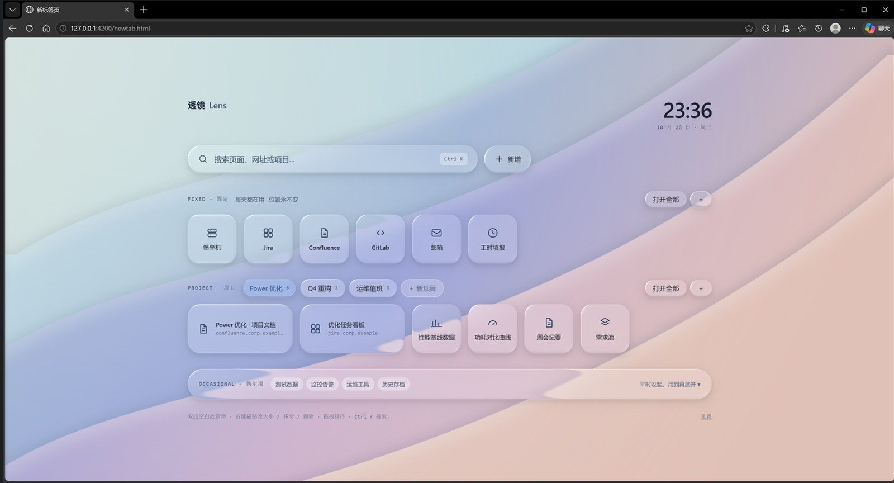

# 栖 · Perch

> 页面栖身的地方。

一个把 Edge / Chrome 新标签页换成**液态玻璃磁贴板**的浏览器扩展。

玻璃不是 CSS 模糊做出来的——它由 [透镜 Lens 设计系统](https://github.com/ruiqichenbiec/design-systems) 的
WebGL2 渲染器**实时折射**背景的极光场景，移动窗口、拖拽磁贴时折射会真实变化。



## 它解决什么

新标签页通常只有两件事要做：**一眼找到要开的页面**，以及**不要越用越乱**。
所以页面按"生命周期"分成三区，而不是按"重要性"：

| 分区 | 放什么 | 什么时候消失 |
| --- | --- | --- |
| **固定** | 每天都用、跟项目无关的页面（堡垒机 / Jira / 邮箱） | 手动删 |
| **项目** | 只在某个项目期间用的页面，顶部切换项目 | 项目结束整块归档 |
| **偶尔用** | 低频但出事时必须能找到（测试数据、历史查询、日志） | 几乎不删，收在抽屉里 |

外加 `Ctrl K` 全局搜索：磁贴负责"不用想就能点"，搜索负责"想不起在哪"。

## 安装

1. 打开 `edge://extensions`（Chrome 用 `chrome://extensions`）
2. 打开右下角 **开发人员模式**
3. 点 **加载解压缩的扩展**，选择本目录
4. 新开一个标签页即可

> 这是未打包的开发版本，浏览器每次启动可能会提示"关闭开发者模式扩展"。
> 长期使用需要上架商店，或按组织的策略用企业打包。

## 使用

- **点磁贴** → 当前标签页打开
- **拖拽** → 排序，可跨区拖动
- **右键磁贴** → 改大小（1×1 / 2×1 / 2×2）、移到其他区、删除
- **双击空白处** → 新增
- **`Ctrl K`** → 搜索全部页面
- **点「偶尔用」横条** → 展开抽屉
- **右键项目标签** → 重命名 / 归档。归档的项目收进底部「档案库」，可以恢复或永久删除
- **右键抽屉条目** → 换分组 / 删除；**右键分组标签** → 重命名 / 删除分组
- 底部 **导入收藏夹** → 列出来源书签，勾选后选择导入到固定区 / 某个项目 / 某个分组
- 底部 **导出布局 / 导入布局** → 备份成 JSON，换电脑或重装后用同一个文件恢复
- 底部 **重置** → 清空成空白页（不恢复示例数据）
- 想看填好的样子：`导入布局` → 选 `docs/sample-layout.json`

数据全部存在扩展自己的 `localStorage`（键名 `perch:v1`），不上传任何地方。
重装扩展、换电脑时用「导出布局」下载 JSON 带过去，「导入布局」回填即可。

## 权限

| 权限 | 用途 |
| --- | --- |
| `bookmarks` | **只读**：把收藏夹导入到「偶尔用」。不修改书签，不联网上传。 |

不导入收藏夹的话，这个权限可以删掉，其余功能不受影响。

## 目录

```
manifest.json          MV3 清单，chrome_url_overrides 接管新标签页
newtab.html            页面骨架
src/
  app.js               全部逻辑：图标 / 数据 / 渲染 / 交互 / 玻璃启动
  aurora.js            极光画法（经典脚本，首帧之前就把背景画好）
  newtab.css           版式与兜底样式
vendor/lens/           透镜 Lens 设计系统运行时（上游副本，勿改，见其 UPSTREAM.md）
icons/                 图标（由 tools/make-icons.py 生成）
tools/make-icons.py    重新生成图标
docs/preview.jpg       截图
docs/sample-layout.json  可导入的示例布局
```

## 性能设计

新标签页一天要开几十次，WebGL 初始化不能挡住第一帧，所以做了两段式：

1. **第 1 帧**：Canvas2D 直接把同样的极光画出来，玻璃用 CSS `backdrop-filter` 兜底 —— 立刻可见
2. **空闲时**（`requestIdleCallback`）再启动 WebGL 渲染器，`stage.webgl-ready` 出现后关掉 Canvas2D

没有 WebGL2 的环境（旧机器、禁用硬件加速、远程桌面）会自动停留在 CSS 玻璃，功能完全不受影响。

**开场遮罩**：两者交接的那一刻（CSS 磨砂 → WebGL 真玻璃）无论怎么对齐都可能被察觉，
所以干脆盖住——先铺一层同色渐变，等渲染器真正画出第一帧（`renderer.lastTime > 0`），
再从左上角用一个圆扩散到右下角把页面擦出来。最迟 2.2 秒必定揭开。

## 已知限制

- 仅在 Edge（Chromium 141）验证过；Chrome / Safari 未测
- 每次新标签页都会重建 WebGL 上下文，低端机上首次渲染可能有 100–300ms 的"CSS 玻璃→真玻璃"切换
- 扩展页面的 `localStorage` 在卸载扩展后会丢失，重要布局请用「导出布局」备份
- 音效默认关闭（Lens 自带 13 种合成音，可在 `src/app.js` 的 `startGlass()` 里打开）

## 更新日志

见 [CHANGELOG.md](CHANGELOG.md)。

## 上游与许可

`vendor/lens/` 是 https://github.com/ruiqichenbiec/design-systems 中
`lens/lab/design-system/` 的运行时子集，版本 `1.1.0-showcase.1`。

- 本项目代码：[MIT](LICENSE)
- 第三方 `vendor/lens/`：遵循其自带的 MIT 许可，版权归原作者，见 `vendor/lens/LICENSE`
  与 `vendor/lens/UPSTREAM.md`

## 下一步

- [x] 导出 / 导入布局 JSON（换机不丢数据）
- [x] 从 Edge 收藏夹批量导入
- [x] 项目归档（收进档案库，可恢复）
- [ ] 「打开全部」真正实现批量开标签
- [ ] 图标支持站点 favicon（需要 `favicon` 权限）
- [ ] 深色场景（Lens 支持 `scene: 'ocean'`）
